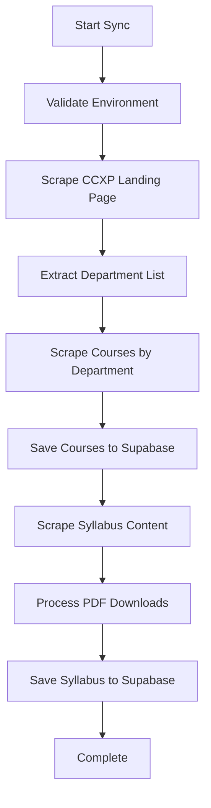

# @courseweb/data-sync

Course data synchronization tools for CourseWeb monorepo.

## Overview

This package provides utilities for synchronizing course data, syllabus information, and search indices from external sources. It has been redesigned to run data scraping operations directly instead of making HTTP calls to API endpoints, making it suitable for containerized deployment and scheduled execution.

The repository's nightly workflow runs at 00:10 Taipei time. With no semester
argument, a run reads dates from `GET /semesters`, syncs the current semester
(the most recently begun semester during breaks), then probes upcoming CCXP
terms in sequence. Each upcoming term gets one course-listing probe before a
full scrape; empty terms skip the full department scrape, syllabus downloads,
and Supabase writes. The run fully syncs at most the first published upcoming
term, so a nightly run covers the current term plus at most one new term.
The GitHub Actions job allows 90 minutes for that workload.
NTHU semester IDs use `10` for fall, `20` for spring, and `30` for summer. The
bundled date table remains the offline fallback.

## Features

- ✅ Direct course data scraping from CCXP system
- ✅ Syllabus content extraction and PDF handling
- ✅ Course and syllabus writes to Supabase search data
- ✅ Docker containerization for cloud deployment
- ✅ GitHub Actions CI/CD pipeline
- ✅ Comprehensive error handling and retry logic
- ✅ Environment validation
- ✅ Concurrent processing with rate limiting

## Quick Start

### Local Development

```bash
# From the repository root, prepare the full backend/data-sync track
bun run setup --full

# Edit tools/data-sync/.env with maintainer-provided credentials
# Run automatic semester selection and sync
bun run --cwd tools/data-sync sync:once

# Run scheduled sync (development)
bun run --cwd tools/data-sync sync:scheduled
```

### Docker Usage

```bash
# Build the image
docker build -t courseweb-data-sync .

# Run automatic semester selection and sync
docker run --env-file .env courseweb-data-sync

# Run with a custom semester
docker run --env-file .env -e SEMESTER=11510 courseweb-data-sync

# Run scheduled sync (persistent container; automatic unless SEMESTER is set)
docker run -d --env-file .env --name courseweb-sync \
  courseweb-data-sync bun run src/update-courses.ts "10 0 * * *"
```

### Docker Compose Usage

For a ready-to-use daily scraping service:

```bash
# Configure tools/data-sync/.env with maintainer-provided credentials
bun run setup --full

# Start scheduled daily sync service
docker-compose up -d

# Run one-time sync
docker-compose run --rm data-sync-once

# View logs
docker-compose logs -f data-sync

# Stop the service
docker-compose down
```

### Google Cloud Run Deployment

The Docker image is automatically built and pushed to GitHub Container Registry via GitHub Actions. You can deploy it to Google Cloud Run for periodic execution:

```bash
# Deploy to Cloud Run
gcloud run deploy courseweb-data-sync \
  --image ghcr.io/nthumodifications/courseweb-data-sync:latest \
  --platform managed \
  --region asia-east1 \
  --set-env-vars SUPABASE_URL=xxx,SUPABASE_SERVICE_ROLE_KEY=xxx \
  --max-instances 1 \
  --timeout 3600 \
  --memory 2Gi \
  --cpu 2 \
  --no-allow-unauthenticated

# Schedule periodic runs with Cloud Scheduler
gcloud scheduler jobs create http courseweb-sync-job \
  --location asia-east1 \
  --schedule "10 0 * * *" \
  --time-zone "Asia/Taipei" \
  --uri https://your-cloud-run-url.a.run.app \
  --http-method POST \
  --oidc-service-account-email your-service-account@project.iam.gserviceaccount.com
```

## Scripts

### Sync Once

Runs a one-time synchronization of course data:

```bash
bun run --cwd tools/data-sync sync:once [semester]
```

With no semester argument, this will:

- Read semester dates from the API and select the current semester
- Probe upcoming CCXP terms one at a time and skip a full scrape when the
  probed department has no courses
- Fully sync at most one published upcoming term after the current term
- Download and process syllabus data
- Write course and syllabus data to Supabase
- Exit when complete

Pass a semester ID to override automatic selection for a one-off run.

### Scheduled Sync

Runs persistent scheduled synchronization:

```bash
bun run --cwd tools/data-sync sync:scheduled [cronPattern] [semester]
```

This starts a persistent process that runs the sync operation on schedule.

### Docker Commands

```bash
# Build image
bun run --cwd tools/data-sync docker:build

# Run container with environment file
bun run --cwd tools/data-sync docker:run
```

## Usage

### From Root Workspace

```bash
# One-time sync
bun run runner:sync-courses

# Scheduled sync (persistent process)
bun run runner:update-courses

# Using workspace commands
bun run sync:once
bun run sync:scheduled
```

### Programmatic Usage

```typescript
import {
  syncCourses,
  runAutoSync,
  startScheduledSync,
  scrapeArchivedCourses,
  scrapeSyllabus,
  validateEnvironment,
} from "@courseweb/data-sync";

// One-time sync
const result = await syncCourses("11510"); // explicit semester override

// Choose the current and upcoming semesters automatically
const automatic = await runAutoSync({ syncSemester: syncCourses });

// Start scheduled sync
const job = startScheduledSync("10 0 * * *"); // automatic selection each day

// Use individual functions
const env = validateEnvironment();
const courses = await scrapeArchivedCourses(env, "11510");
await scrapeSyllabus(env, "11510", courses);
```

### Direct Function Usage

```typescript
import {
  scrapeArchivedCourses,
  scrapeSyllabus,
  validateEnvironment,
  type SyncEnvironment,
} from "@courseweb/data-sync";

const env: SyncEnvironment = {
  SUPABASE_URL: "your-url",
  SUPABASE_SERVICE_ROLE_KEY: "your-key",
};

// Scrape courses and get results
const courses = await scrapeArchivedCourses(env, "11510");

// Process syllabus with scraped courses
await scrapeSyllabus(env, "11510", courses);
```

## Environment Variables

The sync scripts require the following environment variables:

| Variable                    | Description               | Required |
| --------------------------- | ------------------------- | -------- |
| `SUPABASE_URL`              | Your Supabase project URL | ✅       |
| `SUPABASE_SERVICE_ROLE_KEY` | Supabase service role key | ✅       |

Optional variables:

| Variable            | Description                                 | Default                    |
| ------------------- | ------------------------------------------- | -------------------------- |
| `COURSEWEB_API_URL` | API base URL for semester dates             | `https://api.nthumods.com` |
| `CRON_PATTERN`      | Schedule for the optional persistent runner | `"0 0 * * *"`              |

## Configuration

### Semester Selection

Automatic runs use API dates and CCXP course availability. Empty upcoming terms
are checked with one department listing, and later terms are deferred after
the first upcoming term is fully synced. An explicit semester argument or
`SEMESTER` environment variable remains available for one-off backfills and
manual runs.

### Schedule Pattern

The repository workflow runs daily at 00:10 Taipei time (`10 16 * * *` UTC).
The standalone persistent runner accepts its own cron pattern.

Common patterns:

- `"0 8 * * *"` - Daily at 8:00 AM UTC
- `"0 0 * * 0"` - Weekly on Sunday at midnight
- `"0 0 1 * *"` - Monthly on the 1st at midnight

## Data Flow



## Error Handling

- **Retry Logic**: All network operations include exponential backoff retry
- **Graceful Failures**: Individual department/course failures don't stop the entire process
- **Detailed Logging**: Comprehensive logging with emojis for better visibility
- **Environment Validation**: Validates all required environment variables before starting
- **Timeout Protection**: Reasonable timeouts to prevent hanging operations

## Development

```bash
# Install dependencies
bun install

# Build the package
bun run build

# Development mode with watch
bun run dev

# Clean build artifacts
bun run clean

# Lint code
bun run lint

# Type check
bun run type-check

# Build Docker image
bun run docker:build

# Run in Docker
bun run docker:run
```

## CI/CD Pipeline

The package includes GitHub Actions workflow that:

1. **Builds** the Docker image on every push to main
2. **Pushes** to GitHub Container Registry (GHCR)
3. **Tags** with both commit SHA and `latest`
4. **Deploys** automatically on successful builds

The image is available at: `ghcr.io/nthumodifications/courseweb-data-sync:latest`

## Performance & Limits

- **Concurrent Processing**: Processes departments and courses in controlled batches
- **Rate Limiting**: Built-in delays to avoid overwhelming external services
- **Memory Efficient**: Processes data in chunks to handle large datasets
- **Timeout Protection**: 5-minute timeout for course scraping, 20-minute for syllabus
- **Retry Logic**: Up to 6 retries with exponential backoff

## Monitoring & Logs

The application provides detailed logging:

- 🚀 Process start/completion
- 📚 Course scraping progress
- 📝 Syllabus processing status
- 🔍 Supabase course and syllabus writes
- ❌ Error details with context
- 📊 Statistics and performance metrics

## Dependencies

### Runtime Dependencies

- `node-schedule`: For scheduled job execution
- `linkedom`: For HTML parsing in worker environment
- `@supabase/supabase-js`: Database operations

### Development Dependencies

- `tsx`: TypeScript execution
- `tsup`: Build tooling
- `typescript`: Type checking
- Various linting and formatting tools

## Deployment Examples

### Cloud Run with Terraform

```hcl
resource "google_cloud_run_service" "courseweb_data_sync" {
  name     = "courseweb-data-sync"
  location = "asia-east1"

  template {
    spec {
      containers {
        image = "ghcr.io/nthumodifications/courseweb-data-sync:latest"

        env {
          name  = "SUPABASE_URL"
          value = var.supabase_url
        }

        env {
          name  = "SUPABASE_SERVICE_ROLE_KEY"
          value = var.supabase_key
        }

        # ... other env vars

        resources {
          limits = {
            memory = "2Gi"
            cpu    = "2000m"
          }
        }
      }

      timeout_seconds = 3600
    }
  }
}
```

### Kubernetes Deployment

```yaml
apiVersion: batch/v1
kind: CronJob
metadata:
  name: courseweb-data-sync
spec:
  schedule: "10 0 * * *"
  timeZone: "Asia/Taipei"
  jobTemplate:
    spec:
      template:
        spec:
          containers:
            - name: data-sync
              image: ghcr.io/nthumodifications/courseweb-data-sync:latest
              env:
                - name: SUPABASE_URL
                  valueFrom:
                    secretKeyRef:
                      name: courseweb-secrets
                      key: supabase-url
              # ... other env vars
              resources:
                limits:
                  memory: "2Gi"
                  cpu: "2000m"
          restartPolicy: OnFailure
```

## Contributing

1. Fork the repository
2. Create a feature branch
3. Make your changes
4. Add tests if applicable
5. Submit a pull request

## License

MIT License - see LICENSE file for details.

## Notes

- Sync operations have timeout protections (5 minutes for courses, 20 minutes for syllabus)
- All operations include proper error handling and logging
- The containerized version exits after completion, suitable for scheduled cloud runs
- Docker image is automatically built and deployed via GitHub Actions
- Supports both one-time and scheduled execution modes
